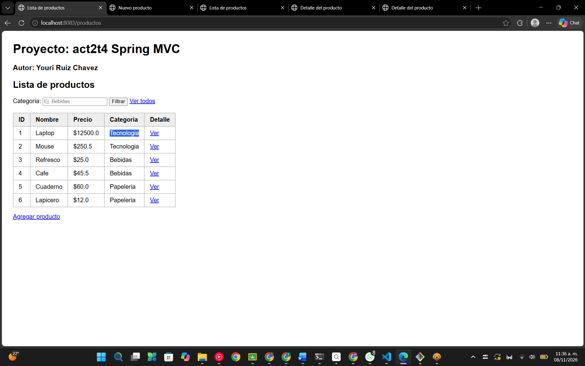
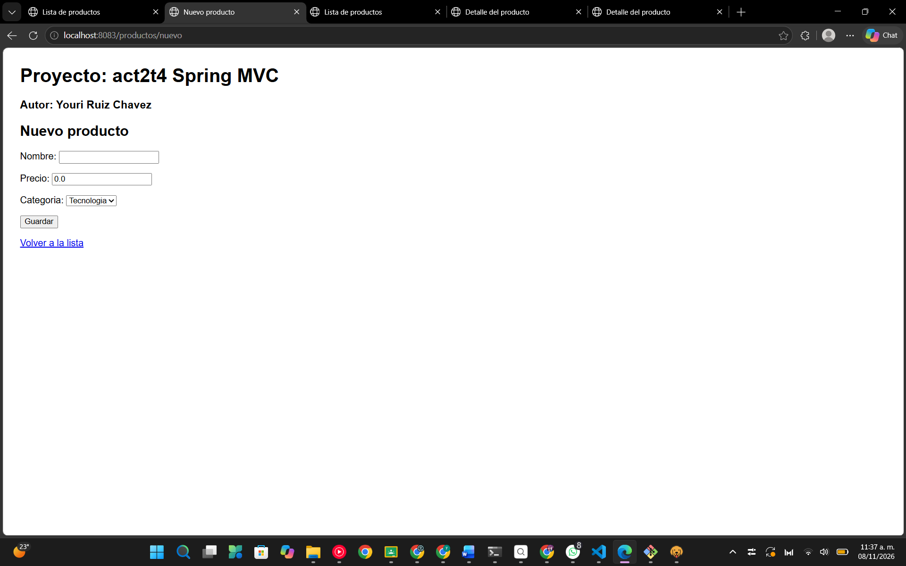
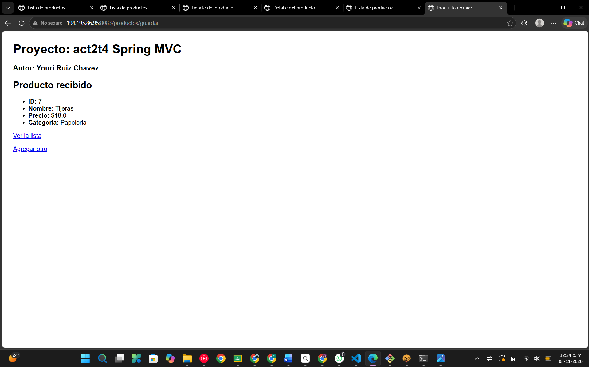
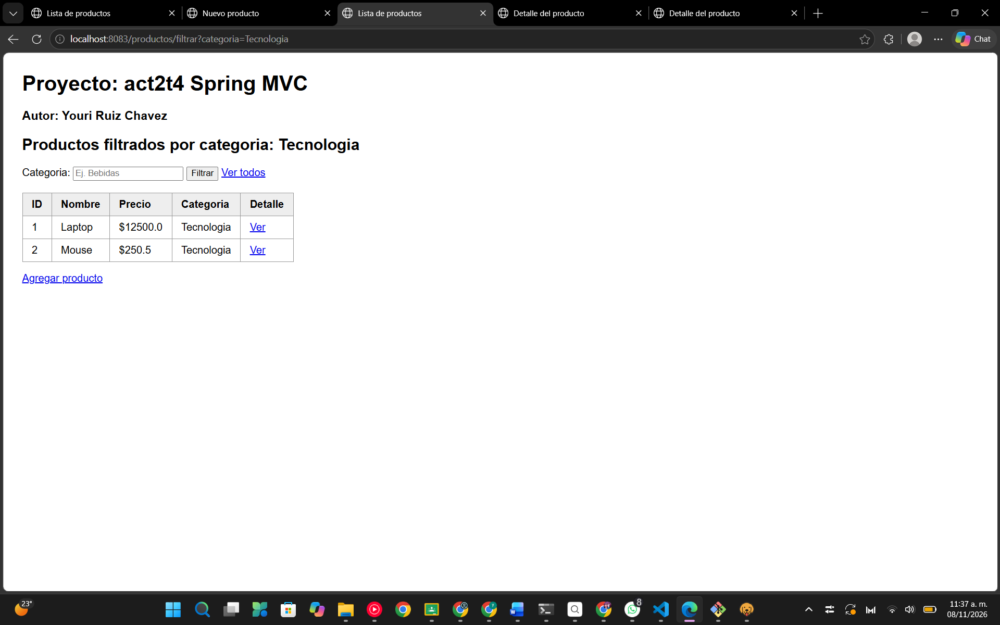
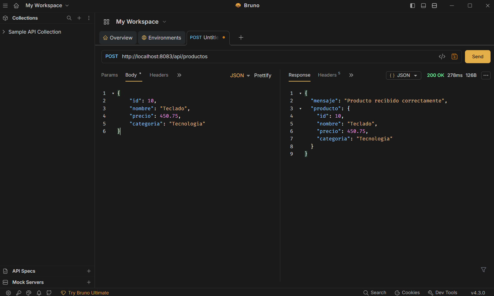
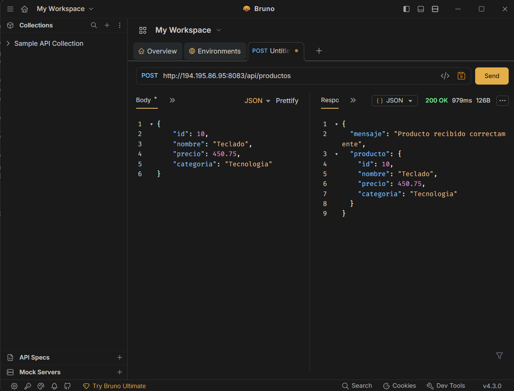
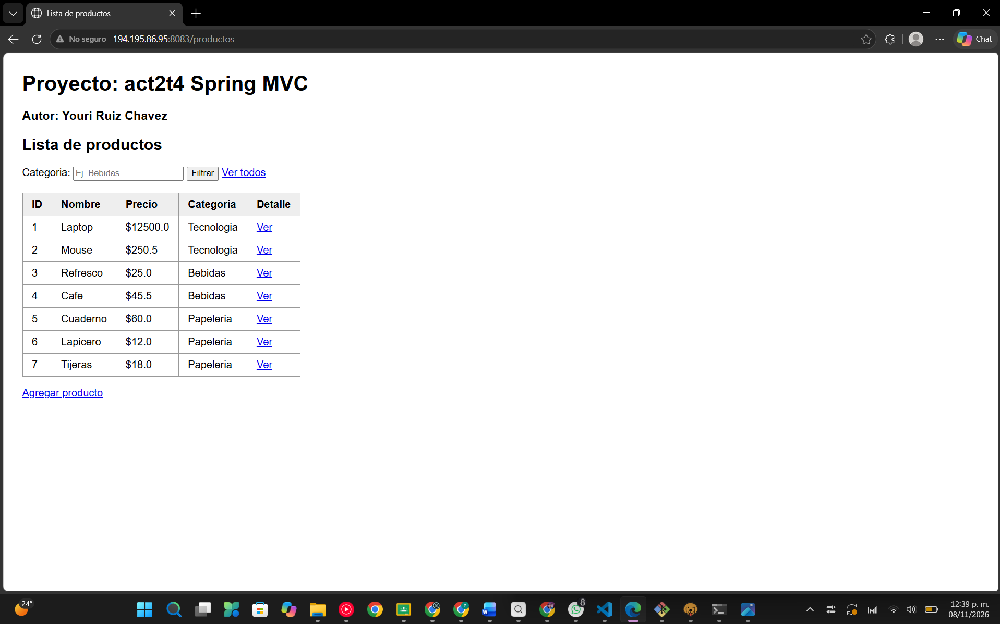
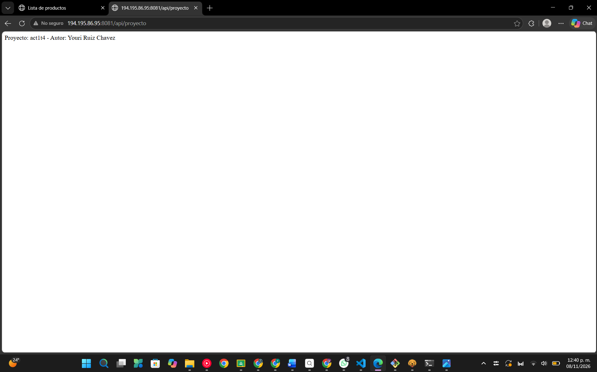

# YJRC_act2_t4 - Spring MVC con Thymeleaf, DTOs y manejo de peticiones

**Alumno:** Youri Ruiz Chavez
**Materia:** Programacion Web
**Actividad:** A2. Act2. Spring MVC - Vistas con Thymeleaf, DTOs y Manejo de Peticiones

Proyecto creado a partir de una copia del proyecto de la Actividad 1 (`YJRC_act1_t4`), que se conserva sin cambios en su propio repositorio.

## Tecnologias

- Java 21
- Spring Boot 4.1.2 (Maven)
- Thymeleaf (`spring-boot-starter-thymeleaf`, ya incluida en el `pom.xml`)
- Bruno para probar el POST

## Estructura (patron MVC)

- **Modelo:** `models/dto/ProductoDTO.java` (id, nombre, precio, categoria)
- **Vista:** `templates/` -> `lista.html`, `formulario.html`, `resultado.html`, `detalle.html`
- **Controlador:**
  - `ProductoController` (@Controller): devuelve vistas Thymeleaf
  - `ProductoRestController` (@RestController): endpoint POST que devuelve JSON

## Endpoints

| Metodo | Ruta | Descripcion | Anotacion principal |
|---|---|---|---|
| GET | `/productos` | Lista de productos con `th:each` | `Model` |
| GET | `/productos/nuevo` | Formulario de captura | `@ModelAttribute` |
| POST | `/productos/guardar` | Recibe los datos del formulario | `@ModelAttribute` |
| GET | `/productos/filtrar?categoria=Bebidas` | Filtra por categoria | `@RequestParam` |
| GET | `/productos/{id}` | Detalle de un producto | `@PathVariable` |
| POST | `/api/productos` | Recibe JSON con el DTO y responde JSON | `@RequestBody` |

Las propiedades `config.autor` y `config.proyecto` se leen de `application.properties` con `@Value` y se muestran en todas las vistas.
## Direcciones en la VPS

La Actividad 2 corre en el puerto **8083** de la VPS. La Actividad 1 sigue corriendo en su puerto original, el **8081**.

### Actividad 2 - Vistas Thymeleaf

| Categoria | URL |
|---|---|
| Lista de productos (`th:each`) | http://194.195.86.95:8083/productos |
| Formulario (`@ModelAttribute`) | http://194.195.86.95:8083/productos/nuevo |

Al presionar **Guardar** en el formulario se envia un POST a `/productos/guardar` y se muestra la vista de resultado. Esa ruta solo se usa desde el formulario (no se abre escribiendola en el navegador).

### Actividad 2 - @RequestParam (filtrar por categoria)

| Categoria | URL |
|---|---|
| Todas (sin filtro) | http://194.195.86.95:8083/productos/filtrar |
| Tecnologia | http://194.195.86.95:8083/productos/filtrar?categoria=Tecnologia |
| Bebidas | http://194.195.86.95:8083/productos/filtrar?categoria=Bebidas |
| Papeleria | http://194.195.86.95:8083/productos/filtrar?categoria=Papeleria |

### Actividad 2 - @PathVariable (detalle por id)

| Producto | URL |
|---|---|
| 1 - Laptop | http://194.195.86.95:8083/productos/1 |
| 2 - Mouse | http://194.195.86.95:8083/productos/2 |
| 3 - Refresco | http://194.195.86.95:8083/productos/3 |
| 4 - Cafe | http://194.195.86.95:8083/productos/4 |
| 5 - Cuaderno | http://194.195.86.95:8083/productos/5 |
| 6 - Lapicero | http://194.195.86.95:8083/productos/6 |
| Id que no existe (prueba) | http://194.195.86.95:8083/productos/99 |

### Actividad 2 - API REST (POST con JSON) ESTO SE HACE EN BRUNO

| Metodo | URL |
|---|---|
| POST | http://194.195.86.95:8083/api/productos |

### Actividad 1 (sigue corriendo en su puerto original, 8081)

| Categoria | URL |
|---|---|
| Nombre del proyecto (texto) | http://194.195.86.95:8081/api/proyecto |
| Lista de materias (JSON) | http://194.195.86.95:8081/api/materias |
| Estado (objeto JSON) | http://194.195.86.95:8081/api/estado |
| Vista de bienvenida (Thymeleaf) | http://194.195.86.95:8081/bienvenida |

Repositorio de la Actividad 1: https://github.com/youri22-eng/YJRC_act1_t4

## Capturas

### Lista de productos (th:each)

### Formulario con @ModelAttribute

### @RequestParam (filtrar por categoria)

### @PathVariable (detalle por id)

### POST probado en Bruno tanto en LOCAL COMO EN LA VPS

## Despliegue en la VPS

- Actividad 2: `http://194.195.86.95:8083/productos` (puerto 8083)
- Actividad 1 (sigue corriendo): `http://194.195.86.95:8081/api/proyecto` (puerto 8081)

